<!-- ================================================= -->
<!-- DEEPALI KUMARI | PREMIUM GITHUB DEVELOPER PROFILE -->
<!-- ================================================= -->

 

  

---

👩‍💻 About Me
Hi! I'm Deepali Kumari, a Computer Science student at IIT Patna, passionate about Software Engineering and Full Stack Development.
- 🎓 B.Sc. Computer Science & Data Analytics — IIT Patna
- 💻 Full Stack Developer
- 🌍 Open Source Contributor
- 🏆 OpenCode'25 — Rank 40
- 🚀 Building impactful software projects
- 🎯 Aspiring Software Engineer
## 🛠️ Technical Skills

### Programming Languages

### Frontend Development

### Backend Development

### Databases

### AI / ML

- TensorFlow Lite
- NumPy
- Basic Audio Processing

### Developer Tools

### Core Computer Science

- Data Structures & Algorithms
- Object-Oriented Programming
- Database Management Systems
- REST API Development
- JWT Authentication

---

## 💼 Professional Experience

### Project Manager Intern — KRISLUXECO

July 2026 – Present

`React` `Node.js` `Express.js` `Project Management`

- Collaborated with business and engineering teams on full-stack product development.
- Coordinated 15+ cross-functional meetings.
- Managed 10+ B2B marketplace accounts.
- Supported technical documentation and product delivery.

### Front-End Developer Intern — She Safe

May 2026 – June 2026

`HTML` `CSS` `JavaScript` `React.js`

- Built responsive user interfaces and reusable frontend components.
- Translated UI designs into functional web pages.
- Improved usability through bug fixes and responsive layouts.

### Web Developer — Dynamisers Solutions

January 2026 – April 2026

`HTML` `CSS` `JavaScript` `WordPress`

- Maintained WordPress websites.
- Performed content updates and HTML/CSS modifications.
- Resolved UI-related issues and performed responsive testing.

---

## 🚀 Featured Projects

### 01. KSP IntelliCrime — AI Crime Intelligence Platform

`React` `TypeScript` `Node.js` `Express.js` `Zoho Catalyst` `JWT`

- Developed an AI-powered crime intelligence platform.
- Implemented FIR management and GIS-based crime mapping.
- Built analytics features and REST APIs.
- Integrated AI-powered FIR summarization using Zoho Catalyst.

### 02. AEGIS — P2P Mesh Communication Platform

`Flutter` `Dart` `WebRTC` `Flask`

- Built an offline-first peer-to-peer communication platform.
- Developed networking modules including Mesh Router, Peer Manager and WebRTC Manager.
- Focused on decentralized communication and connectivity.

### 03. AuraShield AI — Deepfake Voice Detection

`Kotlin` `Jetpack Compose` `TensorFlow Lite` `Python`

- Developed an AI-powered Android application for deepfake voice detection.
- Implemented audio preprocessing using Mel-Spectrograms.
- Worked on real-time scam voice detection.

---

## 🏆 Achievements & Open Source

- 🥇 Achieved Rank 40 Overall in OpenCode'25.
- 🚀 Contributed 27+ merged pull requests in OpenCode'25.
- 🌱 Contributor at Social Summer of Code (SSoC 2026).
- 💻 Achieved 4 merged pull requests in SSoC 2026.
- ✨ Selected Contributor at Winter of Code — World of Coders Society.

---

<!-- GITHUB ANALYTICS -->

<h2 align="center">📊 GitHub Analytics</h2>

<picture>
  <source
    media="(prefers-color-scheme: dark)"
    srcset="https://raw.githubusercontent.com/deepali-kumari-iitp/deepali-kumari-iitp/profile-redesign/assets/cards.dark.svg"
  />

  
</picture>

---

<h2 align="center">✨ Open Source Journey</h2>

---

---

## 🏅 GitHub Trophies

---

## 🌐 Let's Connect

I'm always interested in connecting with developers, collaborating on projects and contributing to open source.

  

### 💚 Thanks for visiting my profile!

**Keep building. Keep learning. Keep growing.**

