 <!-- ================================================= -->
<!-- DEEPALI KUMARI | GITHUB DEVELOPER PORTFOLIO -->
<!-- ================================================= -->

 

  

---

## 👩🏻‍💻 About Me

I'm **Deepali Kumari**, a Computer Science and Data Analytics undergraduate at **IIT Patna**, interested in building practical software solutions and understanding how scalable applications work.

My primary interest lies in Software Engineering, Full Stack Development, Backend Engineering and Open Source.

I enjoy taking ideas from concept to implementation, experimenting with technologies and collaborating with developers to build useful products.

- 🎓 Pursuing B.Sc. in Computer Science & Data Analytics at IIT Patna.
- 💻 Interested in Software Engineering and Full Stack Development.
- ⚙️ Exploring backend systems, APIs and software architecture.
- 🌍 Actively participating in open-source communities.
- 🏆 OpenCode'25 — Rank 40 Overall.
- 🎯 Working towards becoming a Software Engineer.

---

## 🛠️ Technical Skills

### Programming Languages

### Frontend Development

### Backend Development

### Databases

### AI / Machine Learning

- TensorFlow Lite
- NumPy
- Python-based audio processing
- Mel-Spectrograms

### Tools & Platforms

### Computer Science Fundamentals

- Data Structures & Algorithms
- Object-Oriented Programming
- Database Management Systems
- SQL and Relational Databases
- REST API Development
- Authentication & Authorization
- Software Design Fundamentals

---

## 💼 Professional Experience

### Project Manager Intern — KRISLUXECO

July 2026 – Present

`Project Management` `Full Stack Development` `Team Collaboration`

- Collaborating with business and engineering teams on full-stack product development.
- Coordinating 15+ cross-functional meetings.
- Managing 10+ B2B marketplace accounts.
- Supporting technical documentation and product delivery.

### Front-End Developer Intern — She Safe

May 2026 – June 2026

`HTML` `CSS` `JavaScript` `React.js`

- Developed responsive user interfaces and reusable frontend components.
- Translated UI designs into functional web pages.
- Worked on usability improvements, bug fixes and responsive layouts.

### Web Developer — Dynamisers Solutions Pvt. Ltd.

January 2026 – April 2026

`HTML` `CSS` `JavaScript` `WordPress`

- Maintained and updated WordPress websites.
- Implemented content changes and frontend modifications.
- Resolved UI-related issues and performed responsive testing.

---

## 🚀 Featured Projects

### 01. KSP IntelliCrime — AI Crime Intelligence Platform

AI • Full Stack • Crime Intelligence

`React 19` `TypeScript` `Node.js` `Express.js` `PostgreSQL` `Python` `Zoho Catalyst`

- Building an AI-powered crime intelligence platform.
- Working on FIR management and GIS-based crime mapping.
- Developing analytics features and REST APIs.
- Integrating AI-powered FIR summarization.
- Exploring graph-based crime intelligence and data analysis.

### 02. AEGIS — Offline-First P2P Mesh Communication

Decentralized Communication • Networking

`Flutter` `Dart` `WebRTC` `Flask`

- Developing an offline-first peer-to-peer communication platform.
- Working on Mesh Router, Peer Manager and WebRTC Manager.
- Exploring decentralized communication and connectivity.
- Focusing on communication without relying entirely on traditional infrastructure.

### 03. AuraShield AI — Deepfake Voice Detection

Artificial Intelligence • Android Development

`Kotlin` `Jetpack Compose` `TensorFlow Lite` `Python`

- Developed an AI-powered Android application for deepfake voice detection.
- Implemented audio preprocessing using Mel-Spectrograms.
- Worked on real-time scam voice detection.
- Explored machine learning integration in Android applications.

 

---

## 🏆 Achievements & Open Source

- 🥇 Achieved **Rank 40 Overall** in OpenCode'25.
- 🚀 Contributed **27+ merged pull requests** in OpenCode'25.
- 🌱 Contributor at Social Summer of Code (SSoC 2026).
- 💻 Achieved 4 merged pull requests in SSoC 2026.
- ✨ Selected Contributor at Winter of Code — World of Coders Society.

---

## 📊 GitHub Analytics

  

---

## ✨ Beyond Coding

I believe becoming a good engineer is not just about writing code. It's also about learning continuously, collaborating with people and understanding real-world problems.

- 🌱 Exploring new technologies and software architecture.
- 🤝 Collaborating on open-source projects.
- 🧠 Practising problem-solving and Data Structures & Algorithms.
- 🚀 Building projects that solve practical problems.

---

---

## 🌐 Let's Connect

### Let's build something meaningful together! ✨

Always excited to connect with developers, collaborate on innovative projects, contribute to open source, and explore new opportunities.

 

  

---

### 💚 Thanks for visiting my profile!

*Building ideas into reality, one line of code at a time.*

**Keep Building. Keep Learning. Keep Growing.** 🚀

 

